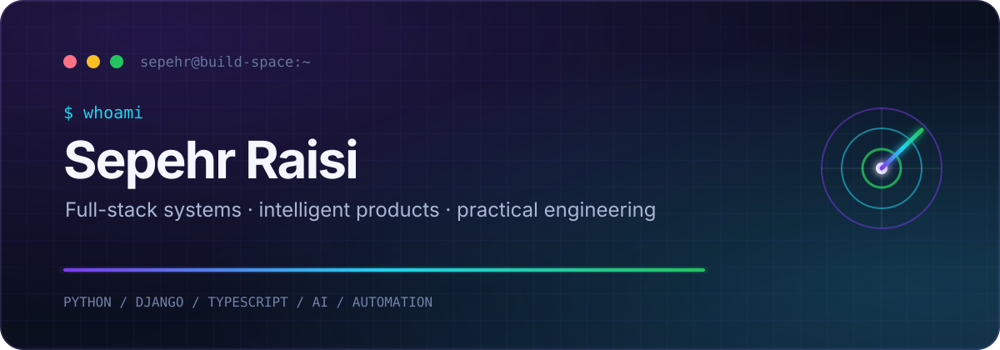

<p align="center">
  
</p>

<p align="center">
  <a href="https://sepehrraisi.ir"></a>
  <a href="https://www.linkedin.com/in/sepehrraisi/"></a>
  <a href="https://github.com/sepehrraisi?tab=repositories"></a>
</p>

<p align="center">
  <code>Python</code>&nbsp;·&nbsp;<code>Django</code>&nbsp;·&nbsp;<code>TypeScript</code>&nbsp;·&nbsp;<code>AI</code>&nbsp;·&nbsp;<code>Automation</code>&nbsp;·&nbsp;<code>Product Engineering</code>
</p>

---

### `01 / SIGNAL`

I’m a full-stack developer from Iran building practical business systems and intelligent products. My work lives where reliable backends, thoughtful interfaces, automation, and real operational needs meet.

```text
FOCUS      full-stack products · CRM & operations · AI-enabled tools
BACKEND    Python · Django · APIs · integrations · automation
FRONTEND   TypeScript · JavaScript · HTML · CSS
BEYOND     computer vision · Android/Kotlin · C++ · Linux tooling
```

> I care about software that feels clear to use, stays maintainable, and solves an actual problem.

### `02 / SELECTED TRANSMISSIONS`

<table>
  <tr>
    <td width="50%" valign="top">
      <h3>⌁ Persian OCR</h3>
      <p>Open-source tooling that helps make optical character recognition more accessible for Persian text.</p>
      <p><code>OCR</code> <code>Python</code> <code>Tesseract</code> <code>Shell</code></p>
      <a href="https://github.com/sepehrraisi/Persian-OCR">View repository →</a>
    </td>
    <td width="50%" valign="top">
      <h3>⌁ Sepuntu</h3>
      <p>A Linux-focused shell project reflecting my interest in automation, systems, and efficient developer workflows.</p>
      <p><code>Shell</code> <code>Linux</code> <code>Automation</code></p>
      <a href="https://github.com/sepehrraisi/Sepuntu">View repository →</a>
    </td>
  </tr>
  <tr>
    <td width="50%" valign="top">
      <h3>⌁ CgLancer Django</h3>
      <p>A full-stack Django project from my earlier web-development work.</p>
      <p><code>Django</code> <code>Python</code> <code>HTML</code> <code>CSS</code></p>
      <a href="https://github.com/sepehrraisi/CgLancer-Django">View repository →</a>
    </td>
    <td width="50%" valign="top">
      <h3>⌁ The current chapter</h3>
      <p>Recent work spans CRM and operations platforms, commerce, TypeScript frontends, AI applications, Android, and embedded experiments.</p>
      <p><code>Private work</code> <code>2025—2026</code></p>
      <a href="https://sepehrraisi.ir">Explore my portfolio →</a>
    </td>
  </tr>
</table>

### `03 / SYSTEM MAP`

<p align="center">
  
</p>

<details>
  <summary><strong>How I tend to work</strong></summary>
  <br />
  <ul>
    <li>Start with the operational problem, not the framework.</li>
    <li>Design the data flow and boundaries before polishing the interface.</li>
    <li>Automate repetitive work and make failure states visible.</li>
    <li>Prefer readable systems that the next developer can confidently change.</li>
  </ul>
</details>

### `04 / TELEMETRY`

<p align="center">
  
  
</p>

<p align="center">
  <sub>Public statistics show only a small part of my recent work; most current product development is in private repositories.</sub>
</p>

---

<p align="center">
  <strong>Have a useful problem worth solving?</strong><br />
  <a href="https://www.linkedin.com/in/sepehrraisi/">Let’s connect</a>
</p>

<p align="center">
  
</p>
